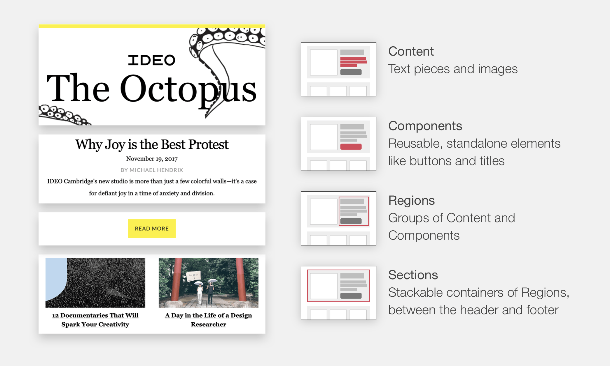

# The Modular Design Method

The modular design method is a model for improving the production process for web content. It uses component-based design and layout patterns that overlap structural coding practices. Its simple definitions allow it to be used across team roles as a way to help each person better describe and understand structure and essentially speak the same language throughout the design workflow.

### Content as data

The bottom level consists of **content** in its raw form, as text pieces and images. This helps separate content from design and aesthetics. It treats content as data and allows for dynamic content to be brought in using data sources.

### Design components

Among content pieces are functional design elements: buttons, headlines, formatted lists, callouts, banners, etc. Standalone, reusable **components** that accompany content. They are the building blocks of your content and should work in a range of contexts. These components are often developed as part of a design system.

### Grouping of content and components

The next level up are **regions**, which group content and components. They are essentially part of a column in a grid-based layout system. And they become functional as repeatable listings.

### Stackable containers

Above regions are **sections** which act as larger containers around regions. They are rows, stacked on top of each other, each consisting of their own columns and creating an overall layout.

### Framing all the pieces

Stacked sections are part of a **frame** that includes the header and footer areas.

## Resources
- [Web design system](https://blocksedit.com/web-design-system/) - guide to designing your web pages modularly for consistency, scalability, and collaboration
- [Starter page components](https://blocksedit.com/starter-page-components/) - HTML template of standard web content components based on hundreds of real-world websites
- [Blocks Edit](https://blocksedit.com) - a CMS that uses classes and attributes in your HTML components to enable editable features in its visual editor